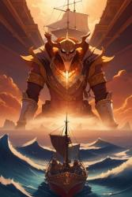
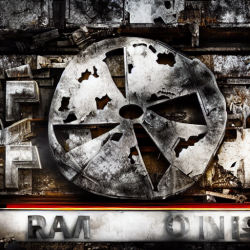

# OpenGameArt: music

**63 assets from [OpenGameArt](https://opengameart.org), dedicated to the public domain under [CC0](https://creativecommons.org/publicdomain/zero/1.0/).** Use them in any game, free or paid, and change them however you like; no credit is needed.

Music from OpenGameArt entries licensed CC0 (some also offer other licences; CC0 is the one that applies here). 900.8 MB in all.

This is a copy kept by [zuujis-cc0](https://github.com/zuujis-cc0) so game makers can take single files from GitHub. It is not made by or affiliated with OpenGameArt: the originals, often in more formats and higher resolutions, are on [opengameart.org](https://opengameart.org). If they help you, consider [supporting OpenGameArt](https://opengameart.org/content/faq).

Every file is listed in [MANIFEST.tsv](MANIFEST.tsv) with its size and SHA-256. More free assets: [the Zuujis collection](https://github.com/zuujis-cc0/free-game-assets#readme).

| | | | |
| :-: | :-: | :-: | :-: |
| <b><a href="outworld">Outworld</a></b> by vitalezzz · <a href="https://opengameart.org/content/outworld">source</a> | <b><a href="overlook-montage">Overlook Montage</a></b> by Grapestar · <a href="https://opengameart.org/content/overlook-montage">source</a> | <b><a href="pale-season">Pale Season</a></b> by Tsorthan Grove · <a href="https://opengameart.org/content/pale-season">source</a> | <b><a href="pan-flute-with-melody-short-2">Pan Flute With Melody Short 2</a></b> by Tozan · <a href="https://opengameart.org/content/pan-flute-with-melody-short-2">source</a> |
| <b><a href="peaceful-3">Peaceful 3</a></b> by Tozan · <a href="https://opengameart.org/content/peaceful-3">source</a> | <b><a href="peaceful-theme">peaceful theme</a></b> by pebonius · <a href="https://opengameart.org/content/peaceful-theme">source</a> | <b><a href="persevere">Persevere</a></b> by vitalezzz · <a href="https://opengameart.org/content/persevere">source</a> | <b><a href="peru-style-3">Peru Style 3</a></b> by Tozan · <a href="https://opengameart.org/content/peru-style-3">source</a> |
| <b><a href="piano-and-strings-melody">Piano and Strings Melody</a></b> by Tozan · <a href="https://opengameart.org/content/piano-and-strings-melody">source</a> | <b><a href="piano-electric-style-4">Piano Electric Style 4</a></b> by Tozan · <a href="https://opengameart.org/content/piano-electric-style-4">source</a> | <b><a href="piano-emotional-51">Piano Emotional 51</a></b> by Tozan · <a href="https://opengameart.org/content/piano-emotional-51">source</a> | <b><a href="piano-melody">Piano melody</a></b> by bramd · <a href="https://opengameart.org/content/piano-melody">source</a> |
| <b><a href="piano-melody-electric-3">Piano Melody Electric 3</a></b> by Tozan · <a href="https://opengameart.org/content/piano-melody-electric-3">source</a> | <b><a href="piano-melody-solo-14">Piano Melody Solo 14</a></b> by Tozan · <a href="https://opengameart.org/content/piano-melody-solo-14">source</a> | <b><a href="piano-melody-solo-15">Piano Melody Solo 15</a></b> by Tozan · <a href="https://opengameart.org/content/piano-melody-solo-15">source</a> | <b><a href="piano-melody-solo-16">Piano Melody Solo 16</a></b> by Tozan · <a href="https://opengameart.org/content/piano-melody-solo-16">source</a> |
| <b><a href="piano-melody-solo-17">Piano Melody Solo 17</a></b> by Tozan · <a href="https://opengameart.org/content/piano-melody-solo-17">source</a> | <b><a href="piano-melody-solo-18">Piano Melody Solo 18</a></b> by Tozan · <a href="https://opengameart.org/content/piano-melody-solo-18">source</a> | <b><a href="piano-melody-solo-19">Piano Melody Solo 19</a></b> by Tozan · <a href="https://opengameart.org/content/piano-melody-solo-19">source</a> | <b><a href="piano-melody-solo-20">Piano Melody Solo 20</a></b> by Tozan · <a href="https://opengameart.org/content/piano-melody-solo-20">source</a> |
| <b><a href="piano-melody-with-drums">Piano Melody With Drums</a></b> by Tozan · <a href="https://opengameart.org/content/piano-melody-with-drums">source</a> | <b><a href="piano-metallic-melody-emotional-1">Piano Metallic Melody Emotional 1</a></b> by Tozan · <a href="https://opengameart.org/content/piano-metallic-melody-emotional-1">source</a> | <b><a href="piano-rythym-1">Piano Rythym 1</a></b> by Tozan · <a href="https://opengameart.org/content/piano-rythym-1">source</a> | <b><a href="piano-with-electric-piano-2">Piano With Electric Piano 2</a></b> by Tozan · <a href="https://opengameart.org/content/piano-with-electric-piano-2">source</a> |
| <b><a href="piano-with-strings-essemble-style-2">Piano with Strings Essemble Style 2</a></b> by Tozan · <a href="https://opengameart.org/content/piano-with-strings-essemble-style-2">source</a> |  <b><a href="pirate-adventure">Pirate Adventure</a></b> by Eldritch Grim · <a href="https://opengameart.org/content/pirate-adventure">source</a> |  <b><a href="pirate-indenture">Pirate Indenture</a></b> by Eldritch Grim · <a href="https://opengameart.org/content/pirate-indenture">source</a> | <b><a href="pirate-ship-theme-loop">Pirate Ship Theme Loop</a></b> by beardalaxy · <a href="https://opengameart.org/content/pirate-ship-theme-loop">source</a> |
| <b><a href="pirates-incoming">Pirates Incoming</a></b> by Eldritch Grim · <a href="https://opengameart.org/content/pirates-incoming">source</a> | <b><a href="pixel-sprinter">Pixel Sprinter</a></b> by Zane Little Music · <a href="https://opengameart.org/content/pixel-sprinter">source</a> | <b><a href="pizza-hell-funiculi-funicula">Pizza Hell (Funiculi Funicula)</a></b> by hencefox · <a href="https://opengameart.org/content/pizza-hell-funiculi-funicula">source</a> | <b><a href="plains-stage">Plains Stage</a></b> by MintoDog · <a href="https://opengameart.org/content/plains-stage">source</a> |
| <b><a href="player-4">player</a></b> by oglsdl · <a href="https://opengameart.org/content/player-4">source</a> | <b><a href="pm-rhythm">PM Rhythm</a></b> by Some Weirdo · <a href="https://opengameart.org/content/pm-rhythm">source</a> | <b><a href="point-sick">Point & Sick</a></b> by iamoneabe · <a href="https://opengameart.org/content/point-sick">source</a> | <b><a href="pointless-loop">Pointless loop</a></b> by iamoneabe · <a href="https://opengameart.org/content/pointless-loop">source</a> |
| <b><a href="port-town-loop">Port Town Loop</a></b> by beardalaxy · <a href="https://opengameart.org/content/port-town-loop">source</a> | <b><a href="predynastic-dawn">Predynastic Dawn</a></b> by Bobjt · <a href="https://opengameart.org/content/predynastic-dawn">source</a> | <b><a href="procedural-midi-music">Procedural MIDI Music</a></b> by Drummyfish · <a href="https://opengameart.org/content/procedural-midi-music">source</a> | <b><a href="psycho-furs-underground-theme">Psycho Furs - Underground Theme</a></b> by Spring Spring · <a href="https://opengameart.org/content/psycho-furs-underground-theme">source</a> |
| <b><a href="pulsar-menu">Pulsar Menu</a></b> by iamoneabe · <a href="https://opengameart.org/content/pulsar-menu">source</a> | <b><a href="pure-raceway">Pure Raceway</a></b> by MintoDog · <a href="https://opengameart.org/content/pure-raceway">source</a> | <b><a href="purgatory-penance-store-closed">Purgatory Penance Store Closed</a></b> by Tozan · <a href="https://opengameart.org/content/purgatory-penance-store-closed">source</a> | <b><a href="purgatory-store-closed">Purgatory Store Closed</a></b> by Tozan · <a href="https://opengameart.org/content/purgatory-store-closed">source</a> |
| <b><a href="puzzled-0">Puzzled</a></b> by iamoneabe · <a href="https://opengameart.org/content/puzzled-0">source</a> | <b><a href="quiet-village-collection">Quiet Village (Collection)</a></b> by Holizna · <a href="https://opengameart.org/content/quiet-village-collection">source</a> | <b><a href="rabble">Rabble</a></b> by GreyFrogGames · <a href="https://opengameart.org/content/rabble">source</a> | <b><a href="racing-game-ending">Racing Game Ending</a></b> by MintoDog · <a href="https://opengameart.org/content/racing-game-ending">source</a> |
| <b><a href="racing-game-finish-jingle">Racing Game Finish & Jingle</a></b> by MintoDog · <a href="https://opengameart.org/content/racing-game-finish-jingle">source</a> | <b><a href="racing-game-menu">Racing Game Menu</a></b> by MintoDog · <a href="https://opengameart.org/content/racing-game-menu">source</a> | <b><a href="racing-game-result">Racing Game Result</a></b> by MintoDog · <a href="https://opengameart.org/content/racing-game-result">source</a> | <b><a href="racing-game-title">Racing Game Title</a></b> by MintoDog · <a href="https://opengameart.org/content/racing-game-title">source</a> |
|  <b><a href="radioactive">Radioactive</a></b> by Eldritch Grim · <a href="https://opengameart.org/content/radioactive">source</a> | <b><a href="ras-quarry">Ras Quarry</a></b> by Bobjt · <a href="https://opengameart.org/content/ras-quarry">source</a> | <b><a href="ras-quarry-ii">Ras Quarry II</a></b> by Bobjt · <a href="https://opengameart.org/content/ras-quarry-ii">source</a> | <b><a href="realm-of-torment">Realm of Torment</a></b> by vitalezzz · <a href="https://opengameart.org/content/realm-of-torment">source</a> |
| <b><a href="redhead-los-gueros-si-saben">Redhead (los gueros si saben)</a></b> by MNDV.ecb · <a href="https://opengameart.org/content/redhead-los-gueros-si-saben">source</a> | <b><a href="relaxing-instrumentals-collection">Relaxing Instrumentals (Collection)</a></b> by Holizna · <a href="https://opengameart.org/content/relaxing-instrumentals-collection">source</a> | <b><a href="relaxing-melody-2">Relaxing Melody 2</a></b> by Tozan · <a href="https://opengameart.org/content/relaxing-melody-2">source</a> | <b><a href="relics-of-past">Relics of Past</a></b> by Centurion_of_war · <a href="https://opengameart.org/content/relics-of-past">source</a> |
| <b><a href="remembrance-loop">Remembrance Loop</a></b> by beardalaxy · <a href="https://opengameart.org/content/remembrance-loop">source</a> | <b><a href="remix">remix.</a></b> by game guy maker · <a href="https://opengameart.org/content/remix">source</a> | <b><a href="results">Results</a></b> by Blocky Modeler · <a href="https://opengameart.org/content/results">source</a> |  |

---

Kept up to date by this repository's own [update workflow](.github/workflows/update.yml), with code and plan from [cc0-mirror](https://github.com/zuujis-cc0/cc0-mirror). Something wrong? [Open an issue there](https://github.com/zuujis-cc0/cc0-mirror/issues/new) or use the [private report form](https://games.zuujis.com/report).
